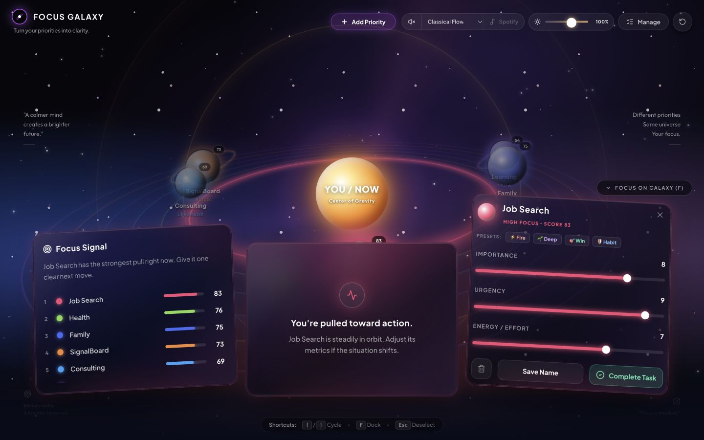
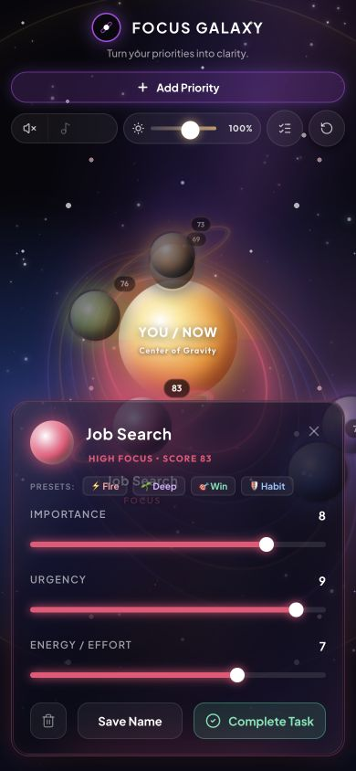

# Focus Galaxy

Focus Galaxy is a local-first focus and priority map that turns tasks into an interactive galaxy and shows what deserves attention now.

## Product screenshots



*Captured from the running app with its six seeded sample priorities.*



*The same live app and sample priorities at a phone-sized viewport.*

## What it does

- Maps importance, urgency, and effort to visual position, size, and activity.
- Shows a deterministic Focus Score from 0–100 with a short rule-based interpretation.
- Lets you add, edit, remove, reset, and locally persist priorities.
- Starts with six seeded priorities so the product is useful immediately.
- Runs without an API key or external service.

The MVP is intentionally frontend-only: priority data is stored in the browser with `localStorage`. The repository is a pnpm workspace that also contains the supporting API and database packages for future extension.

## Stack

- React, Vite, and TypeScript
- Tailwind CSS and Framer Motion
- Express 5, PostgreSQL, and Drizzle ORM in the workspace infrastructure
- Zod validation and generated API contracts

## Run locally

Requirements: Node.js 24+ and pnpm.

```bash
git clone https://github.com/amu3dev/focus-galaxy.git
cd focus-galaxy
pnpm install
pnpm --filter @workspace/focus-galaxy run dev
```

Useful checks:

```bash
pnpm run typecheck
pnpm run build
```

Local development defaults to port `5173` and base path `/`. Set `PORT` or
`BASE_PATH` to override these defaults; static builds require neither variable.

Browser regression checks require a running app and an isolated Chrome profile
with remote debugging enabled. Open the app in that profile, then run:

```bash
pnpm --filter @workspace/focus-galaxy run test:planet-storage-content
pnpm --filter @workspace/focus-galaxy run test:planet-interaction
pnpm --filter @workspace/focus-galaxy run test:planet-cross-tab
```

All three commands default to `APP_URL=http://127.0.0.1:5173/` and `CDP_PORT=9228`;
set these variables to match your setup. Run the suites serially when sharing a
CDP browser. The storage/content and interaction checks replace app data in the test
profile; the cross-tab suite creates disposable browser contexts and downloads test
session copies into `QA_OUTPUT_DIR` (or a temporary directory). The interaction
suite includes a 130-second orbital observation.

When invalid saved priorities or entries are rejected, their original stored text
is retained in localStorage under `focus-galaxy-priorities-v2.corrupt`. Later
distinct recovery copies use `.corrupt-1`, `.corrupt-2`, and so on. If a recovery
copy cannot be written, the app keeps the original value and warns that session
changes will not be saved; freeing browser storage and reloading retries recovery.

Completing a priority now marks it completed without deleting its notes or tasks.
Completed priorities leave the active galaxy and Focus Signal; open **Manage
priorities** and choose **Restore** to bring one back. Completion and restoration
are persisted with the existing storage key. Older records without a completion
flag remain active. Explicit removal and reset still delete data after confirmation.

If a normal storage write fails, changes stay in memory and a persistent **Changes
are not saved** warning offers **Retry save**. Retry checks the loaded content
revision before writing the latest session state; the warning clears only after a successful coordinated save. Closing or reloading
before a successful save can lose session changes. A blocked recovery backup still
requires freeing storage and reloading; Retry save cannot bypass that safeguard.

Cross-tab saves use the exact stored snapshot bytes as a content revision. An
exclusive, same-origin [Web Lock](https://www.w3.org/TR/web-locks/) covers the
revision comparison, any recovery backup, and the snapshot write. This serializes
cooperating tabs without migrating the stored array or introducing a second
revision key that could become inconsistent after a failed write. Each tab tracks
what it loaded or last saved successfully. Failed writes never advance that
revision; retries use the same protection. Obsolete queued saves are cancelled.

Storage events and resume/focus checks surface external changes. A changed
revision blocks writes and keeps session edits in memory. **Download session
copy** exports added notes/tasks and priority changes as JSON; unfinished input
drafts are not included. **Load latest saved version** requires confirmation
before discarding session edits and reloading. Conflicting data is never merged
or overwritten automatically.

A clean stored snapshot is not rewritten on hydration. Necessary initialization
or legacy normalization is guarded by the same locked revision check. Recovery
copies are made only after that check and before replacement; failed initial
reads or failed recovery backups keep persistence blocked until reload.

Safe saving requires Web Locks (HTTPS or a trustworthy local origin). If the API
is missing or unavailable, the app never falls back to an uncoordinated write;
it retains session edits and offers a session copy. **Guarantees apply only to
tabs running this coordination protocol.** An already-open older version, an
extension, or another writer that ignores the lock can still race with or replace
storage. Reload older app tabs before relying on cross-tab protection. Physical
browser/device coverage must be verified separately.

## Deploy on Cloudflare Workers

The app deploys as static assets to <https://focus-galaxy.amu3dev.workers.dev> through Cloudflare Workers Builds, connected to `amu3dev/focus-galaxy`. Pushes to `main` trigger production builds. Cloudflare runs `PORT=18857 BASE_PATH=/ pnpm --filter @workspace/focus-galaxy run build`, then deploys with `pnpm dlx wrangler@4.142.0 deploy --config wrangler.jsonc`. The build root is the repository root.

For a manual deploy, authenticate Wrangler to Cloudflare and run:

```bash
pnpm run deploy:focus-galaxy
```

Live site: <https://focus-galaxy.amu3dev.workers.dev>

The Worker uses the `workers.dev` subdomain and serves the built single-page app from `artifacts/focus-galaxy/dist/public`.

## Optional Spotify playback

Spotify playback is opt-in. Create a Spotify Developer app and copy its Client ID. For local development, put it in `artifacts/focus-galaxy/.env.local` (the Vite app root):

```bash
VITE_SPOTIFY_CLIENT_ID=your_client_id
```

Restart the dev server after changing the value. For the published Cloudflare Worker, add `VITE_SPOTIFY_CLIENT_ID` under the Worker’s **Settings → Build → Build Variables and Secrets**, then trigger a new build/deploy. It must be present during the Vite build: a runtime-only Worker variable will not change the already-built frontend. The Client ID is public; do not put a Spotify Client Secret in the frontend.

In Spotify Developer Dashboard, add each exact Focus Galaxy address you use (preview and published) to the app's Redirect URIs. For the current published site, add `https://focus-galaxy.amu3dev.workers.dev/`. The callback is the current page's origin plus path, so include the same path and trailing slash. Spotify requires HTTPS except for loopback development addresses, and does not allow `localhost`.

The app uses Authorization Code with PKCE and asks the user to authorize playback and playback-control scopes. In Spotify Development Mode, the app owner needs Premium and each user must be allowlisted; browser playback also requires the listening account to have Premium. After connecting, start a Spotify track on another device if there is no active track for Focus Galaxy to transfer. Built-in generated focus music remains available when Spotify is not configured or supported.

## Project structure

```text
artifacts/focus-galaxy/       # Focus Galaxy web app
artifacts/focus-galaxy/src/   # UI, scoring, persistence, and interactions
scripts/                      # Workspace scripts and checks
```

## Product decisions

- A rule-based score keeps the MVP explainable and predictable.
- The visual map makes trade-offs visible instead of hiding them in a list.
- Local persistence keeps the first-use experience simple and private.
